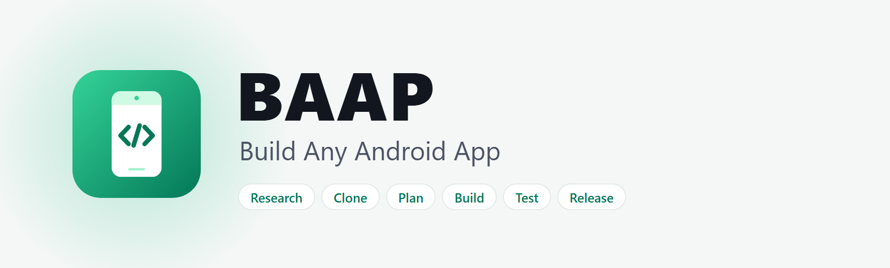

<div align="center">

<picture>
  <source media="(prefers-color-scheme: dark)" srcset="docs/assets/banner-dark.png">
  <source media="(prefers-color-scheme: light)" srcset="docs/assets/banner-light.png">
  
</picture>

### See an app you like. Rebuild it as your own Android app.

Agent skills that take an Android app from idea to a signed release.<br>
Kotlin, Jetpack Compose, Material 3, and Room. Your data stays on the device. Works on Windows, macOS, and Linux.

[](#requirements)
[](#what-you-get)
[](#what-you-get)
[](#what-you-get)
[](#skills)
[](#install)
[](#install)
[](LICENSE)

**[Quick start](#quick-start) · [How it works](#how-it-works) · [What you get](#what-you-get) · [Skills](#skills) · [Enterprise and rugged devices](#enterprise-and-rugged-devices-optional) · [Install](#install)**

</div>

## Quick start

```bash
npx skills@latest add NilupulNishan/baap
```

Then open an empty folder and ask your agent:

```text
Clone my to-do app as an Android app.
Screenshot every screen, write the user stories, and build milestone 1.
```

Not sure where to start? Type `/baap`. It looks at your project and picks
the next skill.

## How it works

<table>
<tr>
<td width="33%" valign="top">

**1. Clone**

Your agent opens the app you like on a device or emulator and screenshots every screen.
It writes a screen index.

</td>
<td width="33%" valign="top">

**2. Plan**

It turns the screens into user stories with checkable acceptance criteria,
in milestones.

</td>
<td width="33%" valign="top">

**3. Build**

It builds one story per commit. Before each commit it runs a self-test on the JVM
and snapshots every screen in light and dark mode.

</td>
</tr>
</table>

The full path, one skill per step:

```text
idea -> research -> clone -> app-brief -> user-stories -> new-android-app
     -> design -> improve-loop (build, test, snapshot, commit) -> release
```

## What you get

Every project starts from a template that works on day one. Your agent
never builds the setup from scratch, so it never guesses library versions
or breaks the build.

| Part | What it gives you |
| --- | --- |
| **Kotlin, Compose, Material 3** | A single-module app, with a bottom bar on phones and a rail on tablets |
| **Local-first data** | Room for records and DataStore for settings. No server, no accounts, works offline |
| **JVM self-test** | Robolectric and Compose drive the real UI: add, rename, star, delete, Undo, restart. No emulator needed |
| **Snapshots** | A PNG of every screen in light and dark, phone and tablet, which the agent looks at before it calls a change done |
| **Grid checks** | A lint and a layout probe that fail when edges do not line up on the 4 dp grid |
| **Design tokens** | One set of colors, gaps, shapes, and motion, plus an accent picker and wallpaper colors in Settings |
| **Launcher icon** | An adaptive icon with a themed layer, rendered to PNGs for review and for Google Play |
| **Test data** | Seed data and tests use an in-memory database, so they never touch real data |

One command checks it all:

```bash
./gradlew check    # lint, unit tests, self-test, snapshots, grid checks (Windows: .\gradlew.bat check)
```

## Skills

<table>
<tr><th>Stage</th><th>Skill</th><th>What it does</th></tr>
<tr><td rowspan="3" valign="top"><b>Start</b></td><td nowrap><a href="skills/start/baap/SKILL.md"><samp>baap</samp></a></td><td>Router: finds where you are and calls the right skill</td></tr>
<tr><td nowrap><a href="skills/start/app-brief/SKILL.md"><samp>app-brief</samp></a></td><td>Turns an idea into a one-page brief</td></tr>
<tr><td nowrap><a href="skills/start/new-android-app/SKILL.md"><samp>new-android-app</samp></a></td><td>A working app from a template: Compose, Room, self-test, snapshots, git. <code>--scanner</code> adds DataWedge scanning</td></tr>
<tr><td rowspan="3" valign="top"><b>Plan</b></td><td nowrap><a href="skills/plan/research/SKILL.md"><samp>research</samp></a></td><td>Parallel researcher agents: market, reviews, features, design, Android APIs</td></tr>
<tr><td nowrap><a href="skills/plan/clone/SKILL.md"><samp>clone</samp></a></td><td>Screenshots every screen of an Android app over adb, writes a screen index</td></tr>
<tr><td nowrap><a href="skills/plan/user-stories/SKILL.md"><samp>user-stories</samp></a></td><td>A backlog with checkable acceptance criteria, in milestones</td></tr>
<tr><td rowspan="4" valign="top"><b>Code</b></td><td nowrap><a href="skills/code/kotlin-compose/SKILL.md"><samp>kotlin-compose</samp></a></td><td>State, effects, coroutines, Room, forms, hardware keys, and fixes for common errors</td></tr>
<tr><td nowrap><a href="skills/code/android-integrations/SKILL.md"><samp>android-integrations</samp></a></td><td>Notifications, background work, files, share, clipboard, camera barcodes, widgets, shortcuts, backup</td></tr>
<tr><td nowrap><a href="skills/code/performance/SKILL.md"><samp>performance</samp></a></td><td>Measure, then fix: startup, jank, long lists, APK size, memory</td></tr>
<tr><td nowrap><a href="skills/code/improve-architecture/SKILL.md"><samp>improve-architecture</samp></a></td><td>Finds hot spots as the app grows and refactors one step per commit, with behavior proven unchanged</td></tr>
<tr><td rowspan="5" valign="top"><b>Design</b></td><td nowrap><a href="skills/design/ux-design/SKILL.md"><samp>ux-design</samp></a></td><td>Names, flow, where each feature opens (inline, sheet, dialog, screen, Snackbar), words, and accessibility, before code</td></tr>
<tr><td nowrap><a href="skills/design/material-design/SKILL.md"><samp>material-design</samp></a></td><td>Material 3 layouts, navigation, type, color roles, dark theme, edge-to-edge, motion, large screens</td></tr>
<tr><td nowrap><a href="skills/design/design-system/SKILL.md"><samp>design-system</samp></a></td><td>An accent people pick in Settings, one set of tokens, and one rules page</td></tr>
<tr><td nowrap><a href="skills/design/layout-grid/SKILL.md"><samp>layout-grid</samp></a></td><td>A 4 dp grid with checks that fail on misalignment: a lint, a layout probe, and a grid overlay</td></tr>
<tr><td nowrap><a href="skills/design/app-icon/SKILL.md"><samp>app-icon</samp></a></td><td>Adaptive launcher icon with a themed layer, the splash icon, and the Play Store icon</td></tr>
<tr><td rowspan="4" valign="top"><b>Ship</b></td><td nowrap><a href="skills/ship/build-and-verify/SKILL.md"><samp>build-and-verify</samp></a></td><td>Build, snapshot every screen in light and dark, look at them</td></tr>
<tr><td nowrap><a href="skills/ship/test-android-app/SKILL.md"><samp>test-android-app</samp></a></td><td>JVM unit tests, a Robolectric self-test, accessibility checks, and device tests</td></tr>
<tr><td nowrap><a href="skills/ship/improve-loop/SKILL.md"><samp>improve-loop</samp></a></td><td>Works through the backlog one story per commit until a milestone is done</td></tr>
<tr><td nowrap><a href="skills/ship/release/SKILL.md"><samp>release</samp></a></td><td>Sign it and ship to Google Play, a GitHub Release, or company devices</td></tr>
<tr><td rowspan="5" valign="top"><b>Enterprise</b></td><td nowrap><a href="skills/enterprise/managed-devices/SKILL.md"><samp>managed-devices</samp></a></td><td>Android Enterprise modes, managed configurations for any EMM, kiosk mode, private apps, testing with Test DPC</td></tr>
<tr><td nowrap><a href="skills/enterprise/rugged-scanning/SKILL.md"><samp>rugged-scanning</samp></a></td><td>Barcode scanning with a rugged device's built-in scanner through DataWedge intents, or EMDK, with a test path that needs no device</td></tr>
<tr><td nowrap><a href="skills/enterprise/rugged-device-config/SKILL.md"><samp>rugged-device-config</samp></a></td><td>What the app does and what IT does: StageNow, MX, OEMConfig, Enterprise Home Screen, DataWedge profiles</td></tr>
<tr><td nowrap><a href="skills/enterprise/label-printing/SKILL.md"><samp>label-printing</samp></a></td><td>Labels to label printers with the Link-OS SDK or raw ZPL over TCP</td></tr>
<tr><td nowrap><a href="skills/enterprise/rfid-reading/SKILL.md"><samp>rfid-reading</samp></a></td><td>RFID tags on handheld and sled readers through DataWedge or the reader's SDK</td></tr>
</table>

## Enterprise and rugged devices (optional)

Many Android apps run on company-owned devices: warehouse handhelds, retail scanners, delivery phones. The
enterprise skills cover them, and they plug in at any step. They stay out of the way if you build for the
Play Store only.

- `managed-devices` is vendor-neutral: it works with any EMM.
- `rugged-scanning`, `rugged-device-config`, `label-printing`, and `rfid-reading` cover rugged handhelds, label printers, and RFID readers. They use only public documentation.
- Create an app that scans with a built-in scanner with one flag:

  ```bash
  node skills/start/new-android-app/scripts/new-app.mjs my-app ~/dev --scanner
  ```

  It adds a `:scanner` module that reads barcodes through DataWedge intents. It needs no SDK and no licence. A test
  on the JVM sends a fake scan, and one `adb` command sends a scan to a phone or emulator. Only a real device with DataWedge
  proves the scanner itself.

> BAAP is an independent open-source project. It is not affiliated with or endorsed by any device maker. Product
> names are trademarks of their owners.

## Try these prompts

```text
/baap I want an app to track the books I read
```

```text
Research the best habit tracker apps, then write a brief for my own.
```

```text
Keep going: finish milestone 1, then stop and show me the screenshots.
```

```text
Make a barcode scanning app for warehouse handhelds. Scans become inventory counts.
```

## Install

Pick one route per agent. Two routes install every skill twice.

<details open>
<summary><b>Claude Code</b></summary>

```text
/plugin marketplace add NilupulNishan/baap
/plugin install baap@baap
```

</details>

<details>
<summary><b>Codex</b></summary>

```bash
codex plugin marketplace add NilupulNishan/baap
codex plugin add baap@baap
```

</details>

<details>
<summary><b>Any other agent</b> (Cursor, Gemini CLI, Copilot, and more)</summary>

Uses [skills.sh](https://skills.sh). Install all skills, or one with `--skill`.

```bash
npx skills@latest add NilupulNishan/baap -a <agent>
npx skills@latest add NilupulNishan/baap --skill=clone
```

</details>

<details>
<summary><b>By hand</b></summary>

```bash
git clone https://github.com/NilupulNishan/baap.git
node baap/scripts/link-skills.mjs   # links every skill into ~/.claude/skills and ~/.agents/skills
```

</details>

## Requirements

- JDK 17 or later (the template builds with 17 to 21)
- The Android SDK with a platform and build tools. Your agent can set these up:
  see [`setup-toolchain.md`](skills/start/new-android-app/setup-toolchain.md), then run
  `node skills/start/new-android-app/scripts/doctor.mjs`
- Node 20 or later (for the scaffold script), and git
- Windows, macOS, or Linux
- An agent that supports skills: Claude Code, Codex, Cursor, Gemini CLI
- For `clone`: a device or emulator with `adb`, or screenshots from you
- Roughly 4 GB of free memory for a Gradle build

## Contributing

Each skill is one folder: `skills/<stage>/<name>/SKILL.md`. Read
[`.claude/CLAUDE.md`](.claude/CLAUDE.md) for the writing rules and how to
test a change to the template. Issues and pull requests are welcome.

## Sister project

[BAWA](https://github.com/NilupulNishan/bawa) does the same for web apps: React, TypeScript, and a public URL.

## Credits

Skill format and writing rules follow Matt Pocock's
[skills](https://github.com/mattpocock/skills) and his
`writing-for-agents` skill.

## License

[MIT](LICENSE)
